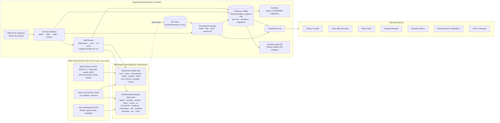

# Saarthi: NSE Trade Cockpit

**Implementation plan, v1.0 (15 Nov 2026)**

Saarthi is a paper-trading cockpit for the Indian cash and F&O market. It runs two open-source skill packs on a fixed NSE schedule. It turns their output into clear trade ideas: when to enter, where to exit, and why. It keeps a permanent record of every decision it made, and lets you practice each idea with simulated money until the numbers prove the idea works.

> **Hard rule: Saarthi never places a real order.** No broker SDK is installed and no broker endpoint is reachable. The order desk only talks to the in-process simulated exchange. This is enforced in code, tests and network policy (§10), not just in documentation.

---

## Contents

1. [Goals and what success looks like](#1-goals-and-what-success-looks-like)
2. [What the two repositories give us](#2-what-the-two-repositories-give-us)
3. [Architecture](#3-architecture)
4. [Technology stack](#4-technology-stack)
5. [Data flow: market data → decision → dashboard](#5-data-flow-market-data--decision--dashboard)
6. [The decision pipeline (how a trade idea is made)](#6-the-decision-pipeline-how-a-trade-idea-is-made)
7. [The simulated-trade engine](#7-the-simulated-trade-engine)
8. [Decision history and performance metrics](#8-decision-history-and-performance-metrics)
9. [UI: screens and wireframes](#9-ui-screens-and-wireframes)
10. [Constraints and how each is enforced](#10-constraints-and-how-each-is-enforced)
11. [Integration steps for both repositories](#11-integration-steps-for-both-repositories)
12. [Sample code](#12-sample-code)
13. [Delivery phases](#13-delivery-phases)
14. [Risks and open questions](#14-risks-and-open-questions)
15. [Execution checklist](#15-execution-checklist)

---

## 1. Goals and what success looks like

| # | Goal | Done when |
|---|---|---|
| G1 | **Show what the skills do** | A new user can open any idea and see every tool that ran, its inputs, its raw output and a plain-English summary. |
| G2 | **Exact ins and outs** | Every idea has an entry trigger (price *and* time window), a stop, one or two targets, a trailing rule, a no-new-entries time and a forced square-off time, all net of Indian costs. |
| G3 | **Show the evidence behind each decision** | Every number on an idea card links to the tool run and data snapshot that produced it. Nothing is computed off the record. |
| G4 | **Historical decisions** | Any past trading day can be opened to show what Saarthi recommended, what it skipped and why, and what then actually happened. |
| G5 | **Simulated trading** | Users can paper-trade live, replay any past session bar by bar ("flight simulator"), or batch-test every past recommendation. Costs, slippage, price bands and the 15:15 square-off are all modelled. |
| G6 | **Honesty check** | A calibration screen compares the odds the skills predicted with what actually happened in paper results. |
| G7 | **Usable by non-experts** | Traffic-light verdicts, plain-language explanations, a glossary on hover, and no command line needed after install. |

**Non-goals:** real order routing, broker logins, tips or calls on any channel, or new indicators beyond what the two repos already compute.

---

## 2. What the two repositories give us

Both packs are MIT-licensed, Python, and have no dependencies apart from one optional package (`yfinance`). Both have test suites, and almost every tool can print JSON (`--json`). That makes them suitable as an engine behind a UI **without modifying them**.

### 2.1 `ogmanojdev/nse-trader-skill`: the intraday research layer

Six skills, with shared code in `nse-common/`. It reads NSE's own data files, plus Yahoo for intraday bars.

| Module | Command | Output | Role in Saarthi |
|---|---|---|---|
| `nse-scanner/scan.py` | `universe`, `daily`, `orb`, `bands` | `universe.txt`, `watchlist.json`, `orb.json`, `bands.json` | Builds the tradable universe (series EQ, no ETFs, not under ASM surveillance). Runs the evening daily scan across about 2,400 names, including delivery-% spikes. Detects opening-range breakouts (ORB) live with `--at` and `--or-minutes`. Flags stocks stuck at a price-band limit. |
| `nse-news/news.py` | `--symbols`, `announcements --hours` | text/JSON | NSE corporate announcements (with a date range, avoiding the 20-row trap) plus press coverage, tagged by type of catalyst, in IST. |
| `nse-timemachine/timemachine.py` | `run --plan --trials --days --at --now` | `timemachine.json` | **The core probability engine.** Rebuilds the rest of the session 10,000 times from the stock's own 5-minute bars at the same time of day, replays every past session too, and reports the odds of target first / stop first / neither, gross and **net** reward:risk, and net expectancy. |
| `nse-alerts/alerts.py` | `add --from-plan`, `check`, `list` | `alerts.json` | Stop, target and 15:15 square-off alerts that know the trading calendar, including Muhurat sessions. |
| `nse-analyst/facts.py` | `SYMBOL`, `--calendar` | `analyst.json` | Filed quarterly results (with the lakh-to-crore unit check) and the results calendar, used to avoid trading into an announcement. |
| `nse-deals/deals.py` | default, `insider --days` | `deals.json` | Bulk and block deals with buyer names, and insider (SEBI PIT) filings, used as evidence of accumulation. |
| `nse-common/charges.py` | `round_trip(entry, exit, qty, product, short)` | dict in `Decimal` | **Single source of truth for costs**: STT, stamp duty, exchange fee, SEBI fee, IPFT, GST, brokerage, DP charges. |
| `nse-common/nsecal.py` | `is_trading_day`, `session`, `bar_slots`, `SQUARE_OFF` | — | **Single source of truth for the clock**: 09:15–15:30 IST, 15:15 square-off, holidays, Muhurat. |
| `nse-common/config.example.json` | — | — | Risk settings (capital, risk %, daily loss cap, minimum R:R 1.5, `no_entries_after` 14:30, `flat_by` 15:15, `paper: true`). Saarthi's Settings screen edits this file directly. |

Two features are central to Saarthi's history and replay modes:
- **`--now "YYYY-MM-DD HH:MM"`** lets the scanner, Time Machine and alerts run as if it were an earlier moment, without seeing later data.
- **`--no-write`** keeps a run from writing files, so Saarthi can capture the run's output itself.

**Deliberately missing:** this repo has no entry, exit, sizing, risk or broker skills. Its README says they belong in a separate risk engine (Sanyam). Saarthi fills that gap using the second repo, *not* new logic of its own (§6).

### 2.2 `Shubhamkumartrichy/claude-trading-skills-india`: the planning and context layer

35 skills and 22 calculators (`skills/*/scripts/*.py`), Python 3.10+, all with `--json`. Saarthi uses these:

| Script | Commands and key flags | Role in Saarthi |
|---|---|---|
| `market-regime/regime.py` | `status`, `distribution`, `ftd`, `trend`, `--as-of`, `--vix` | **Market mood**: NIFTY / BANKNIFTY trend, distribution days, follow-through day (a signal that a new uptrend has started), an exposure ceiling. |
| `market-breadth/breadth.py` | `--json` | How many stocks are joining the index's move. |
| `sector-rotation/sectors.py` | `--json` | Sector relative strength against NIFTY 50. |
| `fii-dii-flows/flows.py` | CSV in, `--json` | Foreign (FII) and domestic (DII) institutional flow streaks, and FII long % in futures. Needs CSVs the user downloads (§14). |
| `event-calendar/events.py` | `window --from --to --symbols --include-expiry`, `next` | RBI, FOMC, CPI, results and expiry dates, giving a yes/no **event-risk gate**. |
| `technical-analysis/ta.py` | `--symbol --period --interval --pivot --trend --json` | Support/resistance levels, pivots, indicator dashboard, multi-timeframe context. |
| `momentum-scanner/momentum.py` | `burst`, `pivot`, `rs`, `--as-of`, `--min-delivery-pct` | Momentum bursts, news gaps, relative-strength ranks. |
| `breakout-planner/breakout.py` | `check`, `plan --capital --risk-pct --stop-method --atr-mult --band --tick --broker` | **Swing entry and exit plans**: Stage-2 / VCP check (a tightening-base breakout pattern), pivot, trigger buffer, stop method, size, and an order plan respecting tick size and price band. |
| `exhaustion-reversal/exhaustion.py` | `climax`, `plan --side --qty` | Signals that a move is running out, used as a **warning against taking an idea**, and for reversal plans. |
| `position-sizing/risk.py` | `size`, `rr`, `trail`, `kelly`, `journal` | **Intraday sizing, R:R / expectancy, the trailing-stop ladder**, and journal statistics. |
| `trading-costs/charges.py` | `--segment --buy --sell --qty --broker --json` | Cost comparison across brokers, used to cross-check `nse-common/charges.py`. |
| `backtest-lab/backtest.py` | `run`, `sweep`, `--start --end --broker --slippage-bps --circuit-band` | Backtests a setup on daily bars with Indian costs, plus walk-forward and Monte Carlo checks. Used for **swing** setup history. |
| `trading-discipline/discipline.py` | journal CSV in | Discipline score for the paper journal: revenge trading, oversizing, rule breaches. |
| `thesis-tracker/thesis.py` | `add`, `update`, `transition`, `note` | Optional lifecycle store for each idea, exportable to the user's own thesis file. |
| `indian-tax-for-traders/tax.py` | `--json` | "What would this paper P&L cost in tax?" on the Performance screen. |
| `fno-options-analysis/options.py` | Greeks, expected move, chain | **Phase 2:** an options lens on index ideas. |

**Excluded:** `broker-integration` (documentation for live brokers) and the optional Groww MCP connection, because they are for real orders. Prompt-only skills (`india-market-analyst`, `stop-loss-strategies`, `trading-discipline` notes, …) are not run as code. Their written guidance is shown in the Learn panel as attributed reference text.

### 2.3 Which repo handles what

```
          nse-trader-skill                           trading-skills-india
  ┌─────────────────────────────┐            ┌─────────────────────────────────┐
  │ WHAT is moving today        │            │ IS the market a place to trade  │
  │  scan daily / orb / bands   │            │  regime · breadth · sectors     │
  │  news · deals · analyst     │            │  flows · events                 │
  │ HOW LIKELY it works         │            │ HOW to trade it                 │
  │  timemachine (net odds)     │◄──plan────►│  breakout plan · risk size/rr   │
  │ WHAT it costs  (charges.py) │            │  trail ladder · exhaustion warn │
  │ WHEN  (nsecal, alerts)      │            │ DID I trade it well             │
  └─────────────────────────────┘            │  journal · discipline · tax     │
                                             │  backtest-lab (swing history)   │
                                             └─────────────────────────────────┘
```

Where both repos cover the same thing, one is the source of truth and the other is a cross-check:
- **Costs:** `nse-common/charges.py`, cross-checked by `trading-costs/charges.py`.
- **Calendar and clock:** `nse-common/nsecal.py`, cross-checked by `event-calendar/events.py` for expiries and macro events.

If the two disagree by more than ₹1 or on a date, the idea card shows a warning chip.

---

## 3. Architecture

> **[PLACEHOLDER: final architecture diagram]** The Mermaid version below is the working draft. Export it to SVG for the design doc.



### Design principles

1. **The repos are the brain; Saarthi is the nervous system.** Saarthi decides *when* to run which tool and *which settings to compare against*. Every price level, probability, cost and size it shows comes from a repo tool. Saarthi's own rules are limited to pass/fail checks against the user's config and to ranking ideas, and both are shown openly as configuration.
2. **Every decision can be reproduced.** Each tool run is stored with the full command line, the repo's commit, the input file hashes, the time the run pretended it was (`--now`), the raw JSON output and the run time. Replaying a decision means re-running those commands.
3. **No knowledge of the future.** Historical days are rebuilt with `--now` / `--as-of`, so the scanner and Time Machine only see data available at that moment.
4. **The UI only ever talks to the simulated exchange.** The UI has no code path to anything that could send a real order.

---

## 4. Technology stack

> **[PLACEHOLDER: confirm choices with the team]** These are recommendations, with the reason and an alternative for each.

| Layer | Recommended | Why | Alternative |
|---|---|---|---|
| Skill runtime | **Python 3.12** (repos need 3.8+ and 3.10+) | Matches both repos. | 3.11 |
| Backend API | **FastAPI + Uvicorn**, Pydantic v2 | Async, typed, WebSockets built in, auto-generated OpenAPI. | Litestar |
| Scheduling | **APScheduler**, with triggers computed from `nsecal` | Fires on NSE sessions (holidays, Muhurat), not a fixed cron. | Celery beat, a custom loop |
| Background jobs | **asyncio TaskGroup + process pool** (later: arq/Redis) | Time Machine runs are CPU-bound, about 1–3 s each. | Celery |
| Decision ledger | **SQLite in WAL mode** for single-user use, **Postgres** for multi-user; SQLAlchemy 2 + Alembic | Append-only audit tables. | — |
| Bar store | **DuckDB over Parquet** | Fast scans over time-of-day slots for heatmaps and replay. | TimescaleDB |
| Frontend | **React 19 + TypeScript + Vite** | Large ecosystem; easy to hire for. | SvelteKit |
| UI kit | **Tailwind + shadcn/ui** (Radix underneath) | Accessible, themeable. | Mantine |
| Price charts | **TradingView Lightweight Charts** (Apache-2.0) | Candles, price lines, markers, opening-range boxes. Fast. | ECharts candlestick |
| Analytics charts | **Apache ECharts** | Heatmaps, donuts, waterfall, calibration plots. | Recharts, visx |
| Data fetching | **TanStack Query** + a native WebSocket | Caching plus live updates. | SWR |
| State | **Zustand** | Small and simple. | Redux Toolkit |
| Tables | **TanStack Table** | Scanner board, history. | AG Grid Community |
| Narrator (optional) | **Claude Agent SDK** with the skill folders loaded and read-only tools | Plain-English explanation of the evidence. Never decides anything. | Off by default |
| Packaging | **Docker Compose** (api, web, worker); a `make dev` path for local use | One-command install. | Tauri desktop app (phase 3) |
| Testing | pytest + hypothesis (fill engine), Playwright (UI), each repo's own `unittest` suite in CI | — | — |

---

## 5. Data flow: market data → decision → dashboard

### 5.1 The trading day, as Saarthi schedules it (all times IST, from `nsecal`)

| When | Job | Tools run | Ledger output |
|---|---|---|---|
| **Previous evening 18:30** (after bhavcopy) | `evening_scan` | `scan.py universe`, `scan.py daily --json --no-write`, `scan.py bands`, `deals.py`, `facts.py --calendar` | Tomorrow's **watchlist**, band/surveillance flags, deals evidence, results-day exclusions |
| **08:30** | `premarket_brief` | `regime.py status --json` (NIFTY, BANKNIFTY), `breadth.py`, `sectors.py`, `flows.py` (if CSVs are present), `events.py window --from today --to today --include-expiry`, `news.py announcements --hours 16` | **Market mood** (go / caution / stand aside), event-risk gate, overnight catalysts |
| **09:00–09:15** pre-open | `preopen_watch` | `news.py --symbols <watchlist>` | Gap and catalyst tags |
| **09:15–09:30** | `orb_forming` | none (the bar store fills in) | Live opening-range box on the chart |
| **09:30 → 14:30**, every 5-minute bar close | `orb_tick` | `scan.py orb --at HH:MM --json --no-write` | Breakout events |
| Each breakout | `build_idea` (§6) | `ta.py`, `momentum.py`, `exhaustion.py climax`, `risk.py size/rr/trail`, `charges.py`, `timemachine.py run --at HH:MM`, `alerts.py add` | A **Trade Idea** with its verdict |
| **14:30** | `entry_window_close` | — | New ideas are marked "too late" (from config `no_entries_after`) |
| **15:15** | `square_off` | — | Simulated exchange closes all intraday (MIS) paper positions |
| **15:45** | `eod_review` | `risk.py journal`, `discipline.py`, outcome scoring for *all* ideas, taken or not | Day report, calibration points |
| **Weekly** | `swing_scan` | `breakout.py check`, `momentum.py rs`, `backtest.py run` for each swing setup | Swing ideas (held over several days, delivery) |

### 5.2 Request path for one idea card

```
UI  GET /ideas/{id}
 └─► API reads ledger.decisions[id]
       ├─ verdict, levels, timing window, size
       ├─ evidence[] → each links to ledger.tool_runs[run_id]
       │      (command, repo SHA, simulated time, input hashes, raw JSON, duration)
       └─ chart overlay → bar_store(symbol, day, 5m) + plan lines + markers
UI  WS  /stream → idea updates, paper fills, alerts, the session clock
```

---

## 6. The decision pipeline (how a trade idea is made)

The pipeline is a fixed sequence of **gates** and **calculations**. Each step runs a repo tool and records its output as evidence. A failed gate does not delete the idea. The idea is stored as **SKIPPED** with the reason, so the user can later ask "what if I had taken the ones Saarthi skipped?"

### 6.1 Intraday opening-range breakout (ORB), the flagship

| Step | Question | Tool (repo) | Pass rule (from user config) |
|---|---|---|---|
| G0 | Is today a session, and is it before the entry cutoff? | `nsecal.session`, config `no_entries_after` | Must be a session and before 14:30 |
| G1 | Is the market a place to be long? | `regime.py status` (CTS) | Regime is not "correction", or exposure ceiling > 0 |
| G2 | Any big event today? | `events.py window` (CTS) | No high-impact event within ±1 session, unless the user overrides |
| G3 | Is the stock tradable? | `scan.py bands` (NTS) | Not stuck at its band limit, not ASM, not in a trade-for-trade series |
| G4 | Results or a fresh filing today? | `facts.py --calendar`, `news.py` (NTS) | No results day, unless the user overrides; catalyst tags attached |
| G5 | Is the breakout real? | `scan.py orb --at` (NTS) | A bar *closed* above the opening-range high, not just traded above it intrabar |
| G6 | Is the move already exhausted? | `exhaustion.py climax` (CTS) | No climax flag above `--min-score` |
| C1 | **Entry** | ORB high from `scan.py orb`; rounded to tick and limited by band via `breakout.py plan --tick --band` (CTS) | Trigger = OR high plus 1 tick; limit = trigger plus a buffer % |
| C2 | **Stop** | Options: OR midpoint (NTS default), OR low, ATR (`risk.py size --atr --atr-mult`), or structure (`ta.py` swing low) | Stop must survive the spread and sit inside the band |
| C3 | **Target(s)** | `risk.py rr --entry --stop --target --cost-pct` (CTS), with targets at net R:R 1.5 and 2.5 | Net R:R must be at least `min_reward_risk` (1.5) |
| C4 | **Size** | `risk.py size --capital --risk-pct --entry --stop --cost-pct` (CTS) | Loss at the stop ≤ risk per trade; daily loss cap not reached; trades per day not exceeded |
| C5 | **Costs** | `charges.round_trip` (NTS), cross-checked by `trading-costs/charges.py` (CTS) | Breakeven per share shown; the cost share of risk shown |
| C6 | **Odds** | `timemachine.py run --plan <C1–C4> --at HH:MM --trials 10000 --days 60 --json` (NTS) | **Net expectancy > 0**, and P(target first) ≥ the user's threshold |
| C7 | **Timing** | `timemachine.py` re-run at each slot from 09:30 to 14:30, giving a **net-expectancy-by-entry-time** curve | Best entry window and "do not enter after" time for this stock |
| C8 | **Exit plan** | `risk.py trail` (trailing-stop ladder), config `flat_by` 15:15, `alerts.py add --from-plan` | Stop → breakeven at +1R, trail by the ladder, flat by 15:15 |

**Verdict** (a configurable ranking rule shown on screen; no hidden model):
- **TAKE** 🟢: every gate passes, net expectancy > 0, and P(target) ≥ the threshold.
- **WATCH** 🟡: every gate passes but the odds are marginal, or the breakout isn't confirmed yet.
- **SKIP** 🔴: any gate fails. The card shows the *first* failing gate as the headline.

**Confidence score**, 0 to 100, explained term by term on the card:

`score = 40·norm(net expectancy) + 25·P(target) + 15·regime + 10·relative strength (momentum) + 10·delivery % / deals evidence`

The weights live in `config/scoring.yaml`. The score is only for ranking; the verdict does not depend on it.

### 6.2 Swing ideas (held for days, delivery)

`breakout.py check`, then `breakout.py plan` (pivot, VCP contraction, stop method, size, order plan), then `backtest.py run --strategy <matching> --broker <profile>` on the same stock, plus `sweep` for a robustness check. Then `event-calendar` and `exhaustion` gates. The verdict uses the backtest's net expectancy and walk-forward result in place of the Time Machine.

### 6.3 Answering "exactly when to get in and out"

Every idea card shows a **Timing Strip**:

```
09:15 ▓▓▓ OR forms ▓▓▓ 09:30 ──●── best entry 09:35–10:20 ──○── fading edge ── 14:30 ✕ no new entries ── 15:15 ⏹ square-off
```

- The **best entry window** is the run of 5-minute slots where the Time Machine's net expectancy at that entry time is above zero and within 80% of its peak (C7).
- **Exit ladder:** initial stop → move to breakeven at +1R → trail by `risk.py trail` → T1 sell half → T2 or trail exit → hard flat at 15:15.
- **Time stop:** if neither stop nor target is hit after N bars, exit. N is the median bars-to-target from the Time Machine's history (Phase 2: make this a setting).

---

## 7. The simulated-trade engine

A small, deterministic exchange that runs inside Saarthi. It works the same way in all three modes:

| Mode | Clock | Data | Use |
|---|---|---|---|
| **Live paper** | Real IST clock | Live bars as they arrive (delayed per source) | Practice on today's ideas as they fire |
| **Replay ("flight simulator")** | Simulated clock, 1×–60× speed or step by step | A stored past session; the pipeline re-runs with `--now` | Practice decisions on a past day without seeing the outcome |
| **Batch backtest** | As fast as possible | All past ideas in the ledger | "If I'd taken every TAKE idea since August…" |

### 7.1 Accounts

- Multiple **paper accounts** (for example "Conservative ₹2L, 0.5% risk" vs "Aggressive ₹5L, 1%"), each with its own config snapshot.
- Starting cash, product types **MIS** (intraday) and **CNC** (delivery). MIS leverage comes from the config placeholder; there is no live broker margin.
- A **daily loss cap** and **max trades per day** from the config. Once a cap is hit, the account is locked for new entries until the next session. Exits stay allowed.

### 7.2 Orders

Order types: `MARKET`, `LIMIT`, `SL` (stop-limit), `SL-M` (stop-market), **`BRACKET`** (entry + stop + target, one cancels the other), **`GTT`** (triggers over several days, for swing), and **`TRAIL`** (stop follows the `risk.py trail` ladder).

Order states: `NEW → TRIGGER_PENDING → OPEN → PARTIAL → FILLED | CANCELLED | REJECTED | EXPIRED`.

**Rejection rules** (each is shown to the user, worded the way a broker would):
- Price not on the stock's tick size (from `breakout.py --tick`).
- Price outside today's price band (from `scan.py bands`). Stock is under ASM or in a trade-for-trade series (no intraday allowed).
- After `no_entries_after`, for entries.
- Size over the risk limit, or the daily cap reached.
- Market closed or a holiday (`nsecal`).

### 7.3 Fill model, bar by bar (the same rules as the Time Machine, so the two can be compared)

For each new bar (1-minute if available, otherwise 5-minute):

1. **Gap open:** if the bar opens past a stop or limit, fill at the **open**, not at the order price.
2. **Stop / SL-M:** triggers when the bar's high (buy) or low (sell) crosses the trigger. Fills at trigger ± slippage.
3. **Limit:** fills if the price traded through the limit by at least one tick. Equal-touch fills are optional (`touch_fill: false` by default, the more cautious choice).
4. **Stop and target in the same bar:** assume the **stop hit first**. This matches the Time Machine's documented pessimistic rule, and the bar is flagged "ambiguous".
5. **Slippage:** `max(1 tick, slippage_bps × price)`, with `slippage_bps` from the config (default 3 bps for NIFTY-100 names, 8 bps for others). A placeholder for a volume-based model.
6. **Band lock:** if the bar sits at the upper/lower band with no trading range, no fill.
7. **Partial fills:** off by default. Placeholder: cap a fill at X% of the bar's volume.
8. **Latency:** an optional N-second delay in live paper mode, to model how long a human takes to act.
9. **Square-off:** at 15:15 (`SQUARE_OFF`), every open MIS position is closed at the next bar's open, tagged `AUTO_SQUARE_OFF`. In a Muhurat session the shortened `nsecal` session is used.

### 7.4 Costs

Each fill pair is priced with **`charges.round_trip(entry, exit, qty, product, short)`** from `nse-common`, imported as a library rather than run as a command, because it is called for every fill. The breakdown (brokerage, STT, stamp, exchange, SEBI, IPFT, GST, DP) is stored per trade and summed per day. Broker cost profiles come from `config.json["charges"]`.

### 7.5 What is recorded per trade

`plan_id, account_id, symbol, side, product, qty, planned_entry, planned_stop, planned_targets[], fills[] (ts, px, qty, reason), exit_reason (TARGET|STOP|TRAIL|TIME|SQUARE_OFF|MANUAL), gross_pnl, costs{…}, net_pnl, R_multiple (net), MAE, MFE (in R), bars_held, slippage_vs_plan, followed_plan (bool), ambiguous_bars, timemachine_p_target, timemachine_net_exp`

### 7.6 Safety

The simulated exchange is the **only** class that implements `OrderGateway`. The live gateway type does not exist. A CI test fails if any module imports a known broker SDK (`kiteconnect`, `upstox_client`, `dhanhq`, `growwapi`, `smartapi`, `alpaca`, …) or contains broker host names (§10).

---

## 8. Decision history and performance metrics

### 8.1 Decision ledger (append-only)

Every idea, **taken or skipped**, is a row. The outcome of every idea, including skipped ones, is scored at the end of the day with the same fill model, as a "ghost trade". That makes it possible to see whether the gates helped.

**History screen views:**
- **Calendar heatmap:** day colour = net paper P&L; a dot per idea.
- **Day timeline:** the session ribbon with every scan event, gate pass/fail, idea, fill and alert, in time order. Click any point to open the evidence.
- **Filters:** verdict, setup (ORB / swing breakout / momentum burst / reversal), regime, sector, time of day, event-day.
- **Counterfactual toggle:** "Show ghost trades of SKIPPED ideas." This answers which gate saved money and which one cost it.
- **Reproduce:** the button re-runs the stored commands at the same repo commit and simulated time, and shows any difference.

### 8.2 Metrics (Performance screen)

| Group | Metrics |
|---|---|
| Results | Net P&L, equity curve, max drawdown, recovery days, profit factor, daily Sharpe/Sortino |
| Per trade | Win rate, **average net R**, expectancy (₹ and R), average MAE/MFE, average bars held, cost as % of gross |
| By setup / time | Expectancy by setup, **by entry-time slot**, by weekday, by regime, by sector, on event days vs normal days |
| **Calibration** ⭐ | Predicted P(target) from the Time Machine, binned in 10% buckets, against the realized hit rate, with a Brier score. **"Is the Time Machine honest for you?"** |
| Plan adherence | % of trades that followed the plan; P&L of trades that followed the plan vs those that didn't |
| Discipline | `discipline.py` score: revenge trades, oversizing, overtrading, rule breaches |
| Gate value | For each gate: ghost P&L of the ideas it blocked. A negative number means the gate saved money. |
| Tax view | `tax.py`: estimated tax on paper gains, intraday treated as speculative business income, with set-off rules |

---

## 9. UI: screens and wireframes

> **[PLACEHOLDER: Figma file link]** The descriptions below are the brief for the designer.

**Design language:** calm and dense, like a pilot's checklist rather than a casino. Green/amber/red appear **only** on verdicts and P&L. Everything else is neutral. Every number has a hover "?" that explains it in one sentence and names its source tool. There is a "Simple / Pro" toggle (Simple hides the raw JSON, Greeks, and score details). Rupee formatting uses Indian grouping (₹1,23,456.78) and IST everywhere. Hindi labels are a Phase 3 item (the India repo already has `README.hi.md`).

### 9.1 Global shell

```
┌──────────────────────────────────────────────────────────────────────────────┐
│ SAARTHI  ● PAPER MODE — no real orders        NIFTY 24,312 ▲0.4%   10:42 IST   │
│ [Today] [Ideas] [Paper Desk] [Replay] [History] [Performance] [Learn] [⚙]       │
│ ▕09:15▓▓OR▓▓09:30━━━━━━━━━━━●now━━━━━━━━━━━━14:30✕━━━15:15⏹━15:30▏              │
└──────────────────────────────────────────────────────────────────────────────┘
```

The **PAPER MODE** badge is always visible and cannot be removed. The session ribbon is driven by `nsecal`.

### 9.2 Today / Cockpit (home)

```
┌─ Market mood ──────────────┐ ┌─ Event risk ───────────┐ ┌─ Paper account ───────┐
│ 🟢 CONFIRMED UPTREND        │ │ ⚠ RBI policy 10:00 Fri  │ │ ₹2,00,000 · Day +₹1,840│
│ Exposure ceiling 80%        │ │ NIFTY weekly expiry Tue │ │ Risk used 0.9% / 2.0%  │
│ Breadth 62% > 20DMA         │ │ 3 watchlist results tmr │ │ Trades 2 / 4           │
│ FII 3-day net buy           │ └─────────────────────────┘ └────────────────────────┘
└─────────────────────────────┘
┌─ Top ideas now ────────────────────────────────────────────────────────────────┐
│ 🟢 TAKE  TATAMOTORS  ORB long  entry ≥ 912.35  stop 905.10  T1 923.20 T2 930.40 │
│          P(target) 58% · net R:R 1.7 · net exp +₹612 · window 09:35–10:20       │
│          [Why?] [Paper trade ▶] [Set alerts]                                     │
│ 🟡 WATCH  LT  swing breakout · waiting for close > pivot 3,644.0                │
│ 🔴 SKIP   ADANIENT  band-locked (G3)                     [see why] [ghost P&L]  │
└──────────────────────────────────────────────────────────────────────────────────┘
┌─ Live feed ─────────────────────────────────────────────────────────────────────┐
│ 10:40 ORB confirmed TATAMOTORS (close 912.80 > OR-high 912.30)                   │
│ 10:35 Filing: LT — order win ₹2,100 cr (NSE announcement)                        │
│ 10:15 Paper fill: BUY 120 HDFCBANK @ 1,642.15 (SL-M trigger)                     │
└──────────────────────────────────────────────────────────────────────────────────┘
```

### 9.3 Idea Detail: "Why this trade" ⭐ the key screen

```
┌ TATAMOTORS · ORB long · 🟢 TAKE · score 78 ───────────────────── [Paper trade ▶] ┐
│ ┌─ Chart (5m, Lightweight Charts) ───────────────────────────────────────────┐  │
│ │ shaded OR box 09:15–09:30 · entry/stop/T1/T2 lines · breakout ▲ marker      │  │
│ │ VWAP · previous day H/L · ta.py pivots · band limits (dashed)               │  │
│ └─────────────────────────────────────────────────────────────────────────────┘  │
│ ┌─ The plan ───────────────────┐ ┌─ The odds (Time Machine, 10,000 runs) ────┐   │
│ │ Buy-stop 912.35 (OR-high+1t) │ │  ◕ target first 58%  ◔ stop 31%  ○ neither │   │
│ │ Limit 913.20                 │ │  net expectancy +₹612/trade (+0.29R)       │   │
│ │ Stop 905.10 (OR midpoint)    │ │  history: 41 past sessions, 24 hit target  │   │
│ │ T1 923.20 (sell ½) T2 930.40 │ │  ⓘ "ambiguous bars" 3 — counted as stop    │   │
│ │ Qty 120 · risk ₹870 (0.44%)  │ └────────────────────────────────────────────┘   │
│ │ Breakeven +₹0.92/share       │ ┌─ When (net expectancy by entry time) ─────┐   │
│ │ Flat by 15:15                │ │ 09:30 ██████ 09:45 ████████ 10:00 ███████  │   │
│ └──────────────────────────────┘ │ 10:30 ████ 11:00 ██ 12:00 ▁ 13:00 ▁▁(neg)  │   │
│ ┌─ Cost of this trade (waterfall) ┐└────────────────────────────────────────────┘ │
│ │ gross +₹1,302 → STT −₹110 → brokerage −₹40 → exch −₹38 → GST −₹14 → stamp …│   │
│ │ → net +₹1,071 at T1          cross-check: trading-costs ✓ (Δ ₹0.40)       │   │
│ └─────────────────────────────────────────────────────────────────────────────┘  │
│ ┌─ Evidence checklist ────────────────────────────────────────────────────────┐ │
│ │ ✓ G1 Market in confirmed uptrend ........ market-regime/regime.py  [raw]   │ │
│ │ ✓ G2 No high-impact event today .......... event-calendar/events.py [raw]   │ │
│ │ ✓ G3 Not band-locked, not ASM ............ nse-scanner bands       [raw]   │ │
│ │ ✓ G4 No results today; 1 filing (order win) nse-news               [raw]   │ │
│ │ ✓ G5 5m close above OR-high at 10:40 ..... nse-scanner orb --at    [raw]   │ │
│ │ ✓ G6 No buying climax .................... exhaustion-reversal     [raw]   │ │
│ │ ✓ Delivery % 2.1× 20-day avg yesterday ... nse-scanner daily       [raw]   │ │
│ │ ✓ Block deal: buyer XYZ MF, 0.4% equity .. nse-deals               [raw]   │ │
│ └─────────────────────────────────────────────────────────────────────────────┘ │
│ ┌─ In plain English ──────────────────────────────────────────────────────────┐ │
│ │ "The market is in an uptrend and TATAMOTORS just closed above its first-15- │ │
│ │  minute high on rising volume, a day after heavy delivery buying. In 41    │ │
│ │  similar past sessions this setup reached the target first 24 times. After │ │
│ │  charges the average outcome is a small profit. Best entry before 10:20."   │ │
│ │  — template text; optional Claude narrator rewrites it from the evidence    │ │
│ └─────────────────────────────────────────────────────────────────────────────┘ │
└──────────────────────────────────────────────────────────────────────────────────┘
```

`[raw]` opens a drawer showing the exact command, repo commit, simulated time, input hashes and the JSON output.

### 9.4 Paper Desk

- **Order ticket:** prefilled from the idea. The user can adjust qty, stop and target. Risk and costs update live using the same tools. The confirm button reads **"Place PAPER order"**.
- **Positions:** live MTM, distance to stop/target in R, "time to square-off" countdown.
- **Orders and fills:** status chips, with rejection reasons in plain language.
- **Account bar:** risk used today vs cap, trades left, lock state.

### 9.5 Replay Simulator ("flight simulator")

- Pick a date, or "surprise me", which hides the date and stock until the end.
- Transport controls: ▶ 1× / 5× / 30× / 60×, ⏭ next bar, ⏭⏭ next event. The chart only reveals bars up to the simulated time.
- The pipeline re-runs with `--now`, so ideas appear exactly when they would have.
- The user trades on the Paper Desk. At the end of the session, a **scorecard** compares "you vs Saarthi's plan vs ideal hindsight".

### 9.6 Decision History, Performance & Calibration, Learn

- **History:** see §8.1.
- **Performance:** see §8.2. The calibration plot is the headline chart.
- **Learn:** a glossary (R, ORB, STT, MIS, ASM, price band, delivery %, expectancy, VCP…). Each term has a 2-line plain explanation, a "show me on a chart" example from the user's own history, and attributed text from the skills' `SKILL.md` files.

### 9.7 Settings

A form editor over `trader/config.json` (capital, risk %, daily cap, min R:R, entry cutoff, flat-by, broker cost profile) and `scoring.yaml`, with inline explanations of what each setting changes. Data source status shows the last successful fetch per source and any throttling warnings.

### 9.8 Accessibility and usability

WCAG 2.2 AA. Colour is never the only signal (icons plus words). Keyboard shortcuts on the desk. Works at 1280 px and up, with a read-only phone layout. Empty states explain what will appear and when ("Ideas appear after 09:30 when the opening range is set").

---

## 10. Constraints and how each is enforced

| Constraint | Enforcement |
|---|---|
| **No real trades** | (1) The only order gateway is the in-process simulator. (2) CI check `test_no_broker.py` scans the code, the dependency lock and the vendored repos' *imported* paths for broker SDKs and host names. (3) `requirements.lock` is hash-pinned; adding a broker package fails review. (4) Optional network allow-list at the container level: only NSE, Yahoo and the user-configured Claude API host. (5) The UI says "PAPER" on every order control. (6) `config.paper` is forced to `true` and the UI cannot change it. (7) The India repo's `broker-integration` skill and the Groww MCP are excluded from loading. |
| **Only the two repos for core trading logic** | Every level, probability, cost, size, gate signal and calendar fact comes from a repo tool output stored in the ledger. Saarthi code covers only scheduling, storage, configurable pass/fail checks, ranking, the fill simulation and display. Code review checklist: "Does this PR compute a market number? If so, where is the repo tool?" The fill engine's rules are the Time Machine's own rules, written down, not a new strategy. |
| **Preserve the repos' functionality, licences and credit** | Both are added as **git submodules pinned to a commit** under `vendor/` and never edited. The tools run as subprocesses; only `nse-common/charges.py` and `nsecal.py` are imported as libraries. Both MIT `LICENSE` files ship in the build. An About page and `THIRD_PARTY_NOTICES.md` credit each repo and author. Each repo's test suite runs in Saarthi's CI against the pinned commit. Upgrades happen by bumping the submodule commit, re-running the tests and checking the calibration has not drifted. |
| **Usable by non-technical users** | Simple/Pro modes, traffic-light verdicts, plain-English summaries, glossary hovers, guided first-run tour, no command line after `docker compose up`. |
| **No extra external data sources** | Saarthi fetches nothing itself. All market data comes through the repos' own fetchers (NSE archives, Yahoo via `nsedata`, and `yfinance` for the India repo's `--symbol`). The bar store is a cache filled from those same tool calls. Sources not yet supported are interface placeholders only: `LiveTickProvider` (a licensed real-time feed) and `FlowsCSVImporter` (manual upload). |
| **Not financial advice** | A first-run acknowledgement, a footer disclaimer, and wording that says "the tools found / the odds were", never "you should buy". The India repo's and NSE repo's disclaimers are shown on the About page. |

---

## 11. Integration steps for both repositories

### Step 1: Vendor the repos, pinned

```bash
git submodule add https://github.com/ogmanojdev/nse-trader-skill vendor/nse-trader-skill
git submodule add https://github.com/Shubhamkumartrichy/claude-trading-skills-india vendor/claude-trading-skills-india
git -C vendor/nse-trader-skill checkout <PINNED_SHA>
git -C vendor/claude-trading-skills-india checkout <PINNED_SHA>
```

### Step 2: Prove they work untouched

```bash
python3 -m unittest discover -s vendor/nse-trader-skill/tests
python3 vendor/nse-trader-skill/tools/vendor.py --check
python3 -m pytest vendor/claude-trading-skills-india/tests   # or unittest; follow the repo's CI workflow
```

Add both to Saarthi's CI matrix.

### Step 3: Write the tool registry

Write `backend/skills/registry.yaml`. Each entry gives the tool's id, script path, Python version requirement, subcommands, the supported time flag (`--now` vs `--as-of`), whether it supports `--json` / `--no-write`, any network needs, a timeout, and the output it is expected to produce. The registry is the only place the backend learns what tools exist.

### Step 4: Build the Skill Runner

The Skill Runner (§12.1):
- Creates a fresh working directory per run, containing `trader/config.json` copied from the account's settings snapshot. This is needed because the NSE tools read and write files under `trader/` relative to where they run.
- Runs the command with `--json --no-write` where supported, with `cwd` set to that directory.
- Captures stdout, stderr and the exit code, parses the JSON, and checks it against a lenient JSON Schema. Unknown fields are kept, so the repos can change their output without breaking Saarthi.
- Writes a `tool_runs` row: command, repo commit, input hashes, simulated time, duration, output.
- Retries once on a network error, with backoff. Yahoo throttling is surfaced as a **degraded** source state rather than a failure.

### Step 5: Shared library imports

Import `nse-common/charges.py` and `nse-common/nsecal.py` for the per-fill cost and clock checks:

```python
sys.path.insert(0, "vendor/nse-trader-skill/nse-common")
import charges, nsecal  # read-only use, no edits
```

### Step 6: India-repo specifics

- Python ≥ 3.10.
- Install the optional `yfinance` package once (`pip install yfinance`) so `--symbol` works, which is the repo's documented path.
- Several skills call sibling scripts, so mount the **whole** `skills/` tree.
- Expose upload endpoints for CSV-driven tools (`flows.py`, the option chain, holdings) and save uploads into the run directory.

### Step 7: Map outputs to the domain model

Write `backend/adapters/*.py`, one small pure function per tool: raw JSON → typed Pydantic models (`Regime`, `EventWindow`, `BandFlag`, `OrbEvent`, `SizeResult`, `RRResult`, `TrailLadder`, `TMResult`, `CostBreakdown`, `BreakoutPlan`, `BacktestResult`). Test them against JSON captured from each repo's own fixtures.

### Step 8: Point-in-time runs

Map `as_of` to the tool's flag:
- NSE tools: `--now "YYYY-MM-DD HH:MM"`, plus `--at HH:MM` for intraday cut-offs.
- India tools: `--as-of YYYY-MM-DD`, plus `--start/--end` for the backtester.

Tools that have no time flag are marked `point_in_time: false` in the registry. The Replay screen then labels their evidence "current, not historical".

### Step 9: Credit

Add `THIRD_PARTY_NOTICES.md` with both full MIT texts, an About page that links both repos, and a footer: "Powered by nse-trader-skill (ogmanojdev) and claude-trading-skills-india (Shubhamkumartrichy)."

### Step 10: Optional narrator

Point the Claude Agent SDK at both repos' skill folders, minus `broker-integration`, with **read-only** tools (the ledger reader and the Skill Runner limited to the registry). Its only job is to turn an idea's evidence into plain English. It cannot create ideas or orders. The system prompt includes the paper-only rule and the not-advice wording.

---

## 12. Sample code

> **[PLACEHOLDER: production versions]** These are reference sketches for the patterns, not final code.

### 12.1 Skill Runner (backend)

```python
# backend/skills/runner.py
import asyncio, hashlib, json, os, shutil, sys, tempfile, time
from dataclasses import dataclass
from pathlib import Path

VENDOR = Path(__file__).resolve().parents[2] / "vendor"

@dataclass
class ToolRun:
    tool_id: str; argv: list[str]; repo_sha: str; as_of: str | None
    exit_code: int; duration_ms: int; output: dict | list | None; stderr: str

async def run_tool(spec, args: list[str], *, config: dict, as_of: str | None = None,
                   inputs: dict[str, bytes] | None = None, timeout: int = 120) -> ToolRun:
    work = Path(tempfile.mkdtemp(prefix="saarthi-"))
    try:
        (work / "trader").mkdir()
        (work / "trader" / "config.json").write_text(json.dumps(config))
        for name, blob in (inputs or {}).items():
            (work / name).write_bytes(blob)

        argv = [sys.executable, str(VENDOR / spec.script), *args]
        if spec.supports_json:     argv.append("--json")
        if spec.supports_no_write: argv.append("--no-write")
        if as_of and spec.time_flag: argv += [spec.time_flag, spec.format_time(as_of)]

        t0 = time.perf_counter()
        proc = await asyncio.create_subprocess_exec(
            *argv, cwd=work, stdout=asyncio.subprocess.PIPE, stderr=asyncio.subprocess.PIPE,
            env={**os.environ, "PYTHONHASHSEED": "0"})
        out, err = await asyncio.wait_for(proc.communicate(), timeout)
        payload = json.loads(out) if out.strip() else None
        return ToolRun(spec.id, argv, spec.repo_sha, as_of, proc.returncode,
                       int((time.perf_counter() - t0) * 1000), payload, err.decode()[-4000:])
    finally:
        shutil.rmtree(work, ignore_errors=True)
```

### 12.2 One pipeline step: the odds and the timing curve

```python
# backend/pipeline/orb.py  (excerpt)
async def odds_and_timing(ctx, plan):
    tm = await ctx.run("nse.timemachine", ["run", "--symbol", plan.symbol,
                        "--entry", str(plan.entry), "--stop", str(plan.stop),
                        "--target", str(plan.target), "--qty", str(plan.qty),
                        "--at", ctx.bar_time, "--trials", "10000", "--days", "60",
                        "--seed", ctx.seed], as_of=ctx.as_of)
    ctx.evidence("C6", "Time Machine odds", tm)

    curve = []
    for slot in ctx.slots("09:30", ctx.cfg["no_entries_after"]):   # nsecal.bar_slots
        r = await ctx.run("nse.timemachine", [..., "--at", slot, "--trials", "2000"],
                          as_of=ctx.as_of)
        curve.append((slot, r.output["expectancy"]["net"]))
    ctx.evidence("C7", "Net expectancy by entry time", curve)
    return tm, best_window(curve, keep=0.8)
```

(Check the exact flag names against `timemachine.py run --help` at the pinned commit. The registry stores them.)

### 12.3 Ledger schema (core tables)

```sql
CREATE TABLE tool_runs (
  id TEXT PRIMARY KEY, tool_id TEXT, argv JSON, repo_sha TEXT, as_of TEXT,
  input_hashes JSON, exit_code INT, duration_ms INT, output JSON, stderr TEXT,
  created_at TEXT DEFAULT CURRENT_TIMESTAMP);

CREATE TABLE decisions (
  id TEXT PRIMARY KEY, session_day TEXT, decided_at TEXT, symbol TEXT, setup TEXT,
  verdict TEXT CHECK (verdict IN ('TAKE','WATCH','SKIP')), first_failed_gate TEXT,
  score REAL, plan JSON,           -- entry, limit, stop, targets[], qty, trail, flat_by, window
  odds JSON, costs JSON, config_snapshot JSON, pipeline_version TEXT);

CREATE TABLE evidence (
  decision_id TEXT REFERENCES decisions(id), step TEXT, label TEXT,
  passed INT, summary TEXT, tool_run_id TEXT REFERENCES tool_runs(id));

CREATE TABLE paper_trades (
  id TEXT PRIMARY KEY, account_id TEXT, decision_id TEXT, mode TEXT,   -- live|replay|batch|ghost
  symbol TEXT, side TEXT, product TEXT, qty INT, fills JSON, exit_reason TEXT,
  gross_pnl REAL, costs JSON, net_pnl REAL, r_multiple REAL, mae_r REAL, mfe_r REAL,
  bars_held INT, followed_plan INT, ambiguous_bars INT);
-- No UPDATE/DELETE on tool_runs/decisions/evidence (enforced by trigger); corrections are new rows.
```

### 12.4 Fill engine core

```python
# backend/sim/fills.py
def step_bar(order, bar, tick, slip_bps):
    """Return a Fill or None. Bars are (ts, o, h, l, c, v). Pessimistic, deterministic."""
    slip = max(tick, round_to_tick(order.ref_price * slip_bps / 1e4, tick))
    if order.kind in ("SL_M", "SL") and order.side == "SELL" and bar.l <= order.trigger:
        px = min(bar.o, order.trigger) - slip            # gap-through fills at open
        return Fill(bar.ts, round_to_tick(px, tick), order.qty, "STOP")
    if order.kind in ("SL_M", "SL") and order.side == "BUY" and bar.h >= order.trigger:
        px = max(bar.o, order.trigger) + slip
        return Fill(bar.ts, round_to_tick(px, tick), order.qty, "ENTRY")
    if order.kind == "LIMIT" and order.side == "SELL" and bar.h > order.limit:  # strict through
        return Fill(bar.ts, max(bar.o, order.limit), order.qty, "TARGET")
    return None

def resolve_bracket(bracket, bar):
    hit_stop   = bar.l <= bracket.stop
    hit_target = bar.h >  bracket.target
    if hit_stop and hit_target:
        return "STOP", True         # same rule as nse-timemachine: ambiguous → stop first
    return ("STOP" if hit_stop else "TARGET" if hit_target else None), False
```

### 12.5 Costs on close (library import)

```python
from decimal import Decimal
import charges  # vendor/nse-trader-skill/nse-common

def close_trade(t):
    rt = charges.round_trip(Decimal(str(t.avg_entry)), Decimal(str(t.avg_exit)), t.qty,
                            product="equity_intraday" if t.product == "MIS" else "equity_delivery",
                            short=(t.side == "SELL"))
    t.costs = {k: str(v) for k, v in rt["entry"].items()} | {"total": str(rt["total"])}
    t.net_pnl = t.gross_pnl - float(rt["total"])
```

### 12.6 Frontend: idea chart overlay

```tsx
// web/src/components/IdeaChart.tsx
import { createChart, CandlestickSeries, LineStyle } from "lightweight-charts";
export function IdeaChart({ bars, plan, orBox }: Props) {
  const ref = useRef<HTMLDivElement>(null);
  useEffect(() => {
    const chart = createChart(ref.current!, { autoSize: true, timeScale: { timeVisible: true } });
    const s = chart.addSeries(CandlestickSeries);
    s.setData(bars);
    const line = (price: number, title: string, color: string, style = LineStyle.Solid) =>
      s.createPriceLine({ price, title, color, lineStyle: style, axisLabelVisible: true });
    line(plan.entry, "Entry", "var(--accent)");
    line(plan.stop, "Stop", "var(--loss)");
    plan.targets.forEach((t, i) => line(t, `T${i + 1}`, "var(--gain)"));
    line(orBox.high, "OR high", "var(--muted)", LineStyle.Dashed);
    line(orBox.low, "OR low", "var(--muted)", LineStyle.Dashed);
    return () => chart.remove();
  }, [bars, plan, orBox]);
  return <div ref={ref} className="h-[360px] w-full" aria-label="Price chart with trade plan" />;
}
```

### 12.7 Safety test

```python
# tests/test_no_broker.py
import pathlib, re, tomllib
BANNED_PKGS = {"kiteconnect", "upstox-python-sdk", "dhanhq", "growwapi", "smartapi-python",
               "alpaca-py", "ib-insync", "fyers-apiv3", "breeze-connect"}
BANNED_HOSTS = re.compile(r"api\.kite\.trade|api\.upstox\.com|api\.dhan\.co|groww\.in/v1|"
                          r"apiconnect\.angelbroking|paper-api\.alpaca|api\.alpaca")
def test_no_broker_dependencies():
    lock = pathlib.Path("requirements.lock").read_text().lower()
    assert not [p for p in BANNED_PKGS if p in lock]
def test_no_broker_hosts_in_our_code():
    for f in pathlib.Path("backend").rglob("*.py"):
        assert not BANNED_HOSTS.search(f.read_text()), f
def test_only_sim_gateway():
    from backend.sim.gateway import OrderGateway
    assert {c.__name__ for c in OrderGateway.__subclasses__()} == {"SimulatedExchange"}
```

---

## 13. Delivery phases

| Phase | Scope | Exit criteria | Est.* |
|---|---|---|---|
| **0. Foundation** | Submodules, CI with both repos' tests, registry, Skill Runner, ledger tables | Every registered tool runs from the API and is stored in `tool_runs` | 1 wk |
| **1. Evening + morning pipeline** | `evening_scan`, `premarket_brief`, Market Mood card, watchlist table | Today screen shows real mood, events, watchlist with evidence drawers | 1.5 wk |
| **2. Intraday ORB ideas** | `orb_tick`, full gate/plan/odds/timing pipeline, Idea Detail screen | TAKE/WATCH/SKIP ideas with full evidence for a live session | 2 wk |
| **3. Simulated exchange** | Accounts, orders, fill engine, costs, square-off, Paper Desk, ghost trades | Property tests pass (no fill outside the bar's range, costs match `charges.py` exactly, all MIS flat by 15:15) | 2 wk |
| **4. History & performance** | Decision calendar, day timeline, metrics, **calibration**, gate value | 20 replayed sessions populate every chart | 1.5 wk |
| **5. Replay simulator** | Simulated clock, `--now` re-runs, transport controls, scorecard | A past day replays with no look-ahead (test: no bar after the simulated time ever reaches the UI) | 1.5 wk |
| **6. Swing mode** | `breakout.py`, `backtest.py`, GTT orders, multi-day holds, CNC costs | Swing ideas with backtest evidence and paper GTT fills | 1.5 wk |
| **7. Polish** | Learn mode, onboarding tour, Simple/Pro, narrator (optional), Hindi labels, Docker one-liner | Usability test: 5 non-technical users finish "find an idea → understand it → paper trade it" without help | 1.5 wk |

\* For one full-stack developer plus part-time design. Phases 3 and 1–2 can run in parallel with two developers.

---

## 14. Risks and open questions

| Risk | Impact | Mitigation |
|---|---|---|
| NSE endpoints change, block or rate-limit (they need a browser-like `Referer`; the archive serves the wrong date with `200 OK`) | Scans fail or are silently wrong | The repos already guard against these (date check inside the bhavcopy, date-ranged announcements). Saarthi adds a source-health panel, caching, and a "degraded" banner. |
| Yahoo throttles by IP for hours | No intraday bars, so no ORB or Time Machine | Respect `--max-charts` and `--pause`. Fill the bar store once and share it between tools. Placeholder `LiveTickProvider` for a licensed feed. Optional: Sanyam's candle store, which the NSE repo supports with `--sanyam`. **This is a third project; ask before adopting it.** |
| Delayed or partial data makes live paper fills too optimistic | Paper results look better than reality | Live paper fills use the *next* bar. Default slippage is cautious. A banner shows the data delay. |
| India repo's flows, option-chain and valuation tools need manual CSV downloads | Gaps in the morning brief | Upload widget with "last updated" ages. Gates that depend on missing data show as "no data", never as pass. |
| Time Machine relies on the last 60 sessions being representative | Odds go stale when conditions change | Calibration screen, a regime label on every idea, and expectancy shown by regime. |
| Upstream repos change their CLI or JSON | Adapters break | Pinned commits, lenient schemas, adapter tests against fixtures, a documented upgrade checklist. |
| Users treat ideas as advice | Regulatory and ethical risk | Paper only. Not-advice wording. No sharing or "signals" export. Disclaimers on first run and on the About page. |
| Cost rates go out of date (STT and charges change by circular) | Wrong net numbers | Rates come from `config.json["charges"]` with a "rates as of" date. The two repos' calculators are cross-checked. Settings shows a stale-rates warning. |

**Open questions for the product owner:**
1. Single user on one machine, or multi-user? This decides SQLite vs Postgres, and whether auth is needed.
2. Include the F&O / options lens (`options.py`) in v1, or phase 2?
3. Allow Sanyam's local candle store as an optional bar source (the NSE repo already reads it)?
4. Turn the Claude narrator on by default? It requires an API key, which the user enters themselves.

---

## 15. Execution checklist

- [x] **Identify the main modules of each repository to integrate.** See §2.1–2.3 and the tool registry in §11, step 3.
- [x] **Define the data flow from market data → decision engine → UI.** See §3 and §5.
- [x] **Design UI components** for historical decisions (§9.6, §8.1), trade recommendations (§9.2–9.3) and simulation controls (§9.4–9.5).
- [x] **Outline the simulated-trade engine and how it records performance.** See §7 and §8.2.
- [x] **Placeholders for technology choices.** See §4, marked for confirmation.
- [x] **All constraints addressed.** See §10.
- [ ] Confirm the answers to the open questions in §14.
- [ ] Pin submodule commits and record them in `registry.yaml`.
- [ ] Designer turns §9 into Figma. Replace the placeholder in §9.
- [ ] Phase 0 kickoff.

---

*Saarthi is educational software that runs simulated trades only. Nothing in it is investment advice. Most intraday traders lose money. Talk to a SEBI-registered investment adviser for advice about your own situation. Trading logic © its authors under the MIT licence: [nse-trader-skill](https://github.com/ogmanojdev/nse-trader-skill) by ogmanojdev, [claude-trading-skills-india](https://github.com/Shubhamkumartrichy/claude-trading-skills-india) by Shubhamkumartrichy.*
